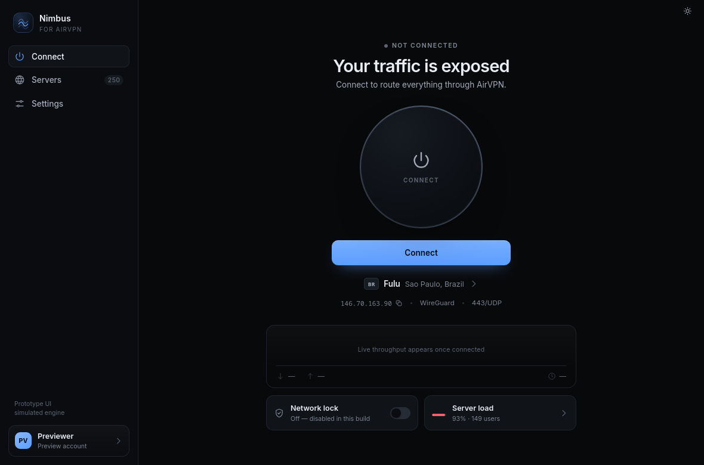
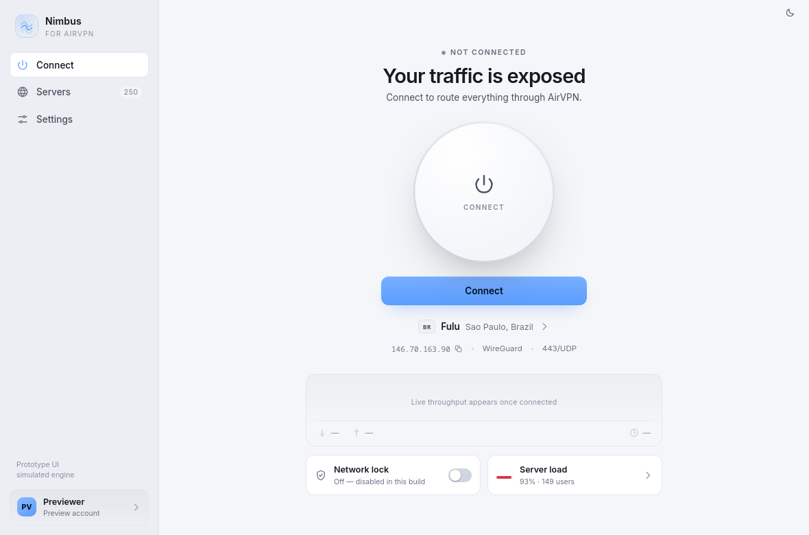
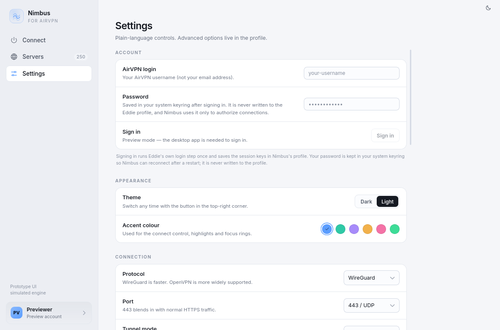
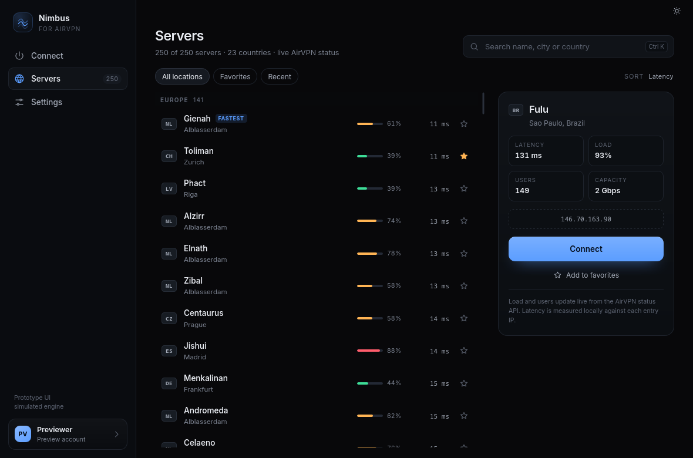

# Nimbus — a cleaner client for AirVPN

An unofficial, Wayland-friendly desktop UI for AirVPN. It **does not touch the VPN
core**: it drives the official Eddie engine (`eddie-cli`) instead of reimplementing
routing, DNS, kill-switch or protocol handling.

> Nimbus is an unofficial client and is not affiliated with or endorsed by AirVPN.



## Why

Eddie's Linux UI is a **Mono `System.Windows.Forms`** app with a custom skin engine
(`src/App.Forms.Linux` references `System.Windows.Forms`, plus `Lib.Forms.Skin`).
That is the source of the blurry text, broken HiDPI, odd tray behaviour and
non-native rendering on Wayland. It is not a theme problem, so it cannot be
fixed by styling Eddie.

Mullvad's client feels good because it is a **thin UI over a daemon**: the daemon
owns state, the UI renders events. Eddie already has the daemon under the hood —
it just never grew a modern frontend.

## What already exists (verified against Eddie 2.26.2 and the AirVPN API)

| Surface | Details |
|---|---|
| `eddie-cli --jsoninout` | Line-delimited JSON over stdin/stdout. Events on stdout (`ui.status`, `ui.main-status`, `log`, `init.step`, `engine.ready`), commands on stdin. There is even `engine.stdin.stop`. |
| Local HTTP API | `POST /api/command/`, `POST /api/pull/`, static `webui` assets, session-cookie auth via `webui.access_key`, plus `/mcp`. |
| Public server data | `https://airvpn.org/api/status/` → 250 servers with `currentload`, `users`, `bw_max`, 4× IPv4, 4× IPv6, `health`. No key. |
| Account data | `https://airvpn.org/api/userinfo/?key=…` → account, expiry, sessions, port forwarding. |
| Privileged layer | Already separated: `eddie-cli-elevated`, `eddie-cli-elevated-service`, polkit, plus shipped `openvpn`, `hummingbird`, `stunnel`, `wireguard-go`. |

### The one hard constraint

Eddie's privileged helper only accepts clients that live **in the same directory**
as the helper, and (for writable installs) match a SHA-256 snapshot of that
directory. So the architecture has to be:

```
Nimbus (Tauri webview)  ──JSON lines──▶  official eddie-cli  ──▶  privileged helper
        UI only                          engine, unchanged          root ops
```

Nimbus never talks to root. It spawns the official CLI from its own install
directory, so the integrity gate is satisfied and the kill switch / DNS / routing
code stays exactly as AirVPN ships it.

Because the engine lives at a stable `/opt/eddie-ui` path, the Nimbus AppImage
is still a single-file UI: it detects the engine, or offers a one-time setup if
Eddie is not installed. Nimbus itself never needs to live next to the engine.

## Run the UI

```bash
pnpm install
pnpm dev            # browser preview with a simulated engine, :5183
pnpm tauri dev      # real window (Tauri 2 + WebKitGTK, native Wayland surface)
```

Inside Tauri, `useEngine()` switches to the **live adapter**
(`src/liveEngine.ts`), which drives the official `eddie-cli --jsoninout`
process. The browser preview stays on the simulated engine so screenshots and
design work never touch the network.

Keyboard: `Ctrl/⌘ 1/2/3` switch views, `Ctrl/⌘ K` focuses server search,
`Esc` clears it.

## Build Linux packages

```bash
pnpm install
pnpm tauri build --bundles deb,appimage
```

Outputs:

```
src-tauri/target/release/bundle/deb/Nimbus_0.1.0_amd64.deb
src-tauri/target/release/bundle/appimage/Nimbus_0.1.0_amd64.AppImage
```

Install the deb with `sudo apt install ./Nimbus_0.1.0_amd64.deb`, or mark the
AppImage executable and run it (FUSE, or `--appimage-extract-and-run`, required).
Neither package bundles Eddie. On first launch, if `eddie-cli` is missing,
Nimbus shows a **one-time engine setup** screen:

1. resolves the official stable Linux build through `eddie.website`;
2. downloads it and checks its SHA-256 checksum;
3. verifies AirVPN's detached OpenPGP signature against a pinned key
   (`239F D950 7903 EA9F BF7D CCF1 C6E3 3885 8A23 9AEC`);
4. extracts the AppImage and installs Eddie plus its privileged helper to
   `/opt/eddie-ui`, with one `pkexec` administrator prompt.

Automatic setup currently targets **x86_64 Linux** and needs `pkexec` (polkit),
`gpg`/`gpgv`, `tar`, and a running polkit agent. Desktop Debian/Ubuntu, Fedora,
Arch and openSUSE installations normally have these. If the helper service has
already been installed elsewhere, choose **Check again** after installing Eddie
manually; Nimbus will use the existing engine.

The deb remains the recommended format on Debian/Ubuntu because desktop
integration is familiar. The AppImage is the portable option for other distros;
both use the same external engine.

The setup follows AirVPN's **stable** channel at the moment it runs. Nimbus 0.1
does not yet update an already-installed engine automatically; if AirVPN ships a
security update, install its official package or replace `/opt/eddie-ui` using
the official installer. An update-check flow is on the roadmap.

## Why Eddie is not bundled

`eddie-cli` is not a self-contained binary. It needs the helper, `openvpn`,
`hummingbird`, `stunnel`, provider resources and the root service from the same
install directory, and Eddie's integrity gate rejects a copy run from a
different location (notably an AppImage's changing mount path). A bundled
AppImage therefore would not actually work as a single-file install.

There are also licence and trust reasons: Eddie is GPL-3.0 and includes
third-party components with their own terms (including a proprietary
WireGuard-NT binary on Windows), and AirVPN's trademarks are not granted by the
GPL. Bundling would make Nimbus responsible for redistributing, updating and
signing the privileged engine. Keeping Eddie as an official, separately
installed dependency preserves its integrity checks, update path and security
fixes. The first-run onboarding downloads AirVPN's own signed build instead of
vendoring a copy; the local installation is the only Eddie copy on the machine.

## Live engine

Nimbus looks for `eddie-cli` in this order: `NIMBUS_EDDIE_CLI`, the directory of
a running `eddie-cli-elevated` helper, standard `/opt/eddie-ui` installs, a
stable extraction at `~/.local/opt/eddie/squashfs-root/opt/eddie-ui`, then
AppImage mounts. The engine is always spawned **from its install directory** so
Eddie's integrity check accepts it.

The privileged helper is still Eddie's own service. The onboarding installs and
registers it from the same stable directory. To refresh it manually after a
manual install (as root):

```bash
sudo /opt/eddie-ui/eddie-cli-elevated service=install service_port=9350
```

Nimbus keeps its own profile at `${XDG_DATA_HOME:-~/.local/share}/nimbus/profile`
(override with `NIMBUS_PROFILE`). It never reads or writes `~/.config/eddie`.

### Sign-in and credentials

Eddie's `--jsoninout` API has no login command: only the console client runs
`Auth()` and writes the authenticated `<user>` node. Nimbus therefore performs
one short console-mode login against its own profile. That is the only step
that uses Eddie's CLI `--password` option; it is short-lived and its output is
not logged.

On a successful sign-in the password is saved in the **operating system's
credential store** (Secret Service / GNOME Keyring on Linux, Credential Manager
on Windows), keyed by the AirVPN login. Nimbus restores it on launch, so normal
restarts start signed in and connect without asking again.
**Settings → Account → Forget saved password** removes the keyring entry while
keeping the account name.

Every engine start is deliberately **idle** (`--connect=false`). Once the
engine reports ready, Nimbus hands it the login and password over stdin
(`options.set`) and only then sends `mainaction.connect`. The password never
appears in the engine's command line, where another local user could read it
from `/proc`, and JSON option-change events are redacted before they reach the
webview or a trace log.

Eddie may cache the password inside its own encrypted profile while a session
is active. Nimbus asks Eddie to clear it before every clean shutdown; a hard
crash can leave an encrypted copy until the next clean stop. The authoritative
copy always remains the system keyring. If the keyring is unavailable, sign-in
still works for the current session and Nimbus shows a non-blocking warning
that the password could not be saved.

### Network lock is deliberately disabled in this build

Eddie exposes no `netlock.*` command over jsoninout, and it only arms or
disarms the firewall during engine startup/shutdown. A connect that fails
inside the provider authorization call can therefore leave the machine with no
network and no way to turn the lock off from the UI. Until that path is
validated, every Nimbus start (connect or idle) passes:

```
--netlock.mode=none --netlock=false --netlock.connection=false
```

**Settings → Network protection → Release network lock** runs a short-lived
engine with the lock disabled, which makes Eddie load its recovery file and
tear down any rules left by an interrupted session. Aborted connects do this
automatically.

## Probe the real engine

Quit Eddie first (its single-instance lock and privileged service belong to the
running install), then:

```bash
node scripts/probe.mjs               # watch the event stream
node scripts/probe.mjs --discover    # ask read-only commands what this build supports
```

It logs everything to `/tmp/nimbus-probe/probe.log`. The first run will raise a
polkit prompt, because `eddie-cli` starts its own privileged helper. The probe
sets `--netlock.mode=none --connect=false`, so it does not touch the tunnel.

Note: the public Eddie source **stubs out `ApiManager`** ("Modern-only commands
are handled by ApiManager (stubbed out for Legacy source publication)"). The
official binary does contain it. The probe answers what the shipped build
actually accepts; until then Nimbus only relies on the documented legacy
commands (`mainaction.connect`, `mainaction.disconnect`, `report.start`) and
CLI/profile options.

## Design notes

- One screen per job: **Connect**, **Servers**, **Settings**.
- The main screen answers four questions in one glance: am I protected, where
  am I exiting, what is my IP/protocol, and is the kill switch on.
- Servers are searchable and sorted by latency, with live load and favorites —
  not a 40-column tree grid.
- Settings are plain language, with the trade-off spelled out. Advanced Eddie
  options stay in the profile.
- Colour is state, not decoration: grey/blue/yellow/green/red.
- Built for Wayland: Tauri 2 + WebKitGTK, custom client-side layout, no
  XWayland-only widgets, HiDPI and fractional scaling handled by the compositor.

## Themes and accent colour

There is a small sun/moon button in the top-right corner of every screen, plus a
full **Appearance** section in Settings. Both write to `localStorage`
(`nimbus.theme`, `nimbus.accent`) and are applied before the first paint by a tiny
inline script, so there is no flash of the wrong theme on launch.

- **Dark / Light** — two hand-tuned palettes. Colour is derived from semantic
  tokens (`--surface`, `--line`, `--text-dim`, `--ok`, …), not per-component
  overrides, so new UI inherits both themes automatically.
- **Six accents** — Sky, Teal, Violet, Amber, Rose, Mint. The accent drives the
  connect button, focus rings, selection, sparkline and the on-state of switches;
  soft/tinted variants are mixed at runtime with `color-mix()`.
- **Status colour stays independent** of the accent: green = protected, amber =
  connecting, red = blocked, so a rose accent never reads as an error.







## Roadmap

1. ~~**Engine adapter** — Rust side that spawns `eddie-cli --jsoninout`, parses
   events into the same state model the mock uses, and writes commands.~~
2. ~~**Real connect/disconnect + server switching** — legacy commands first,
   relaunching the CLI with new options when needed.~~
3. **Account screen** — expiry, devices, port forwarding via `userinfo`.
4. ~~**Keyring** — store the password in the OS keyring so it survives restarts.~~
5. **Tray + notifications** — StatusNotifier on Wayland; connect/disconnect and
   state colour.
6. ~~**Packaging** — deb/AppImage with a verified first-run engine installer
   (`/opt/eddie-ui`) and "Eddie not found" onboarding.~~
7. **Engine updates** — compare the installed Eddie version with AirVPN's
   stable release, then offer a verified update that preserves the helper.
8. **Network-lock parity** — re-enable it once connect can be proven safe:
   provider allowlist + DNS, automatic disarm on every failure path, and a
   visible "lock is armed" indicator.
9. **Parity checks** — DNS-leak test, suspend/resume, network change, IPv6.

### Windows and split tunnelling

**Windows is feasible.** Eddie already ships `eddie-cli.exe` and an elevated
Windows service, and it speaks the same `--jsoninout` protocol. The React UI and
the keyring layer are cross-platform; Tauri uses WebView2 on Windows. The work
is in `src-tauri/src/engine.rs`, which currently uses Linux-only process
primitives (`prctl`/`PDEATHSIG`, `SIGTERM`, `/proc` orphan scans), plus CLI
discovery, installer/packaging and code signing. Expect an MVP port rather than
a one-line build; a Windows VM is required for testing. The Tauri installer will
add Nimbus to the Start menu and Apps list; first-run setup can download and run
AirVPN's official Windows installer under UAC instead of the Linux `pkexec`
path. The netlock-off policy carries over and removes the riskiest
platform-specific piece for now.

**Split tunnelling:** Eddie's core has no application/process-based split
tunnel, and no `split tunnel` code exists in `Lib.Core`. It does support
**destination-route** exceptions through `routes.custom`
(`address-or-range,in|out,note;…`), applied when the tunnel is built. That is
enough for an IP/subnet-based "route these ranges outside the VPN" feature
(reconnect required), with no engine changes. Per-app split tunnelling would
need Nimbus to add its own privileged routing component (cgroups/nftables on
Linux, WFP on Windows), which is a much larger, security-sensitive project and
is deliberately out of scope for v1.

## Legal

Nimbus is licensed **GPL-3.0-or-later** (see `LICENSE`). It does not include or
link Eddie code; Eddie is used as a separate process, so Nimbus can be built and
run with the official engine without modifying it. Eddie itself is GPL-3.0 and
includes third-party components under their own licences.

The AirVPN and Eddie names/logos are trademarks of AirVPN. Nimbus is an
unofficial client with its own branding and no endorsement; do not present it as
an AirVPN release.
